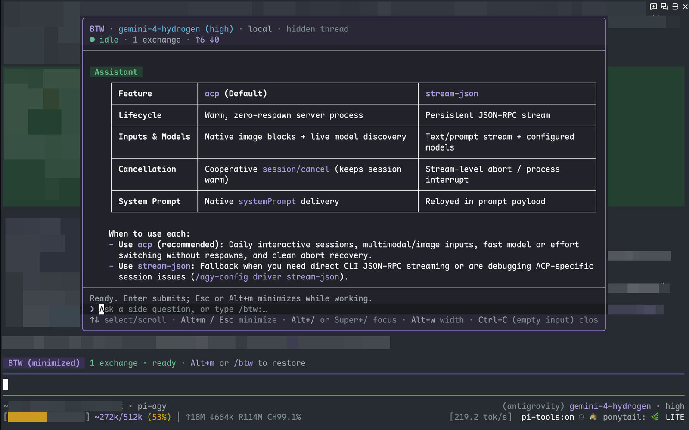
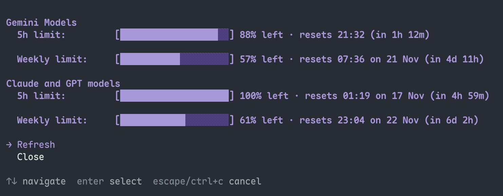

# pi-agy-provider

Run **Google Antigravity** (`agy`) models inside the [Pi coding agent](https://pi.dev), keeping Pi's TUI, tool cards, permissions, skills, MCP servers, and sessions while the official `agy` CLI (`acp` or `stream-json`) runs underneath.

## Why This Exists

I use this extension daily on my own projects and refine it continuously around two goals: **stability** and **speed**. Huge kudos to the Antigravity team for `agy` native and its multi-agent capabilities. `pi-agy-provider` is simply an option if you enjoy working inside Pi's TUI and extension ecosystem; it is **not** a replacement for `agy`, because `agy` itself remains the foundation powering every model turn underneath.

## Install

Requires the official `agy` CLI on `PATH` (sign in inside `agy`, or run `/agy-login` in Pi).

```bash
pi install npm:pi-agy-provider
# or from GitHub:
pi install git:github.com/teededung/pi-agy-provider
```

Update anytime with `pi update npm:pi-agy-provider`.

## Multi-Agent & Workflow Modes

| Command | Mode | What it does |
| --- | --- | --- |
| `/swarm <task>` | **Swarm** | Parallel multi-agent board orchestration (`swarm`, `post_message`, `read_board`, `swarm_wait`) with automatic `@coordinator` wakeups. Toggle session mode via `/swarm on\|off`; inspect live via `/swarm board` or `Alt+s`. |
| `/boost [task]` | **Boost** | Multi-agent orchestrator delegating coding and root-cause work to `DeepCoder` and `DeepInvestigator` subagents (`on\|off\|status`). |
| `/teamwork [idea]` | **Teamwork** | Two-phase workflow: refines `prompt_draft.md` with you first, then launches autonomous specialist teammates (`on\|off\|status`). |
| `/goal <task>` | **Goal** | Autonomous multi-turn loop with self-auditing continuations until the objective completes (`/goal off\|status`). |
| `/grill-me [plan]` | **Grill** | Dependency-ordered frontier design interview using interactive `ask_user_question` cards (or Markdown fallback) before coding (`/grill`, `on\|off\|status`). |
| `/m <spec> <msg>` | **Consult** | One-shot consult with another model/effort without switching your session model, e.g. `/m opus3 review diff`, `/m argon1 quick check` (alias `/consult`). |
| `/btw [prompt]` | **Side chat** | Non-blocking side thread overlay in an isolated runtime (`Esc` / `Alt+m` to minimize, `Alt+/` to restore, `/btw:model`, `/btw:thinking`, `/btw:copy`, `/btw:new`). |

> While `/swarm`, `/boost`, `/teamwork`, or subagents are streaming, pressing `Enter` routes side questions straight into `/btw` instead of stalling in the steer queue (`Alt+Enter` still queues a main-session follow-up).



## Commands

| Command | Description |
| --- | --- |
| `/agy` | Active conversation ID, model, driver, tool mode, and context status |
| `/agy-tools [on\|off\|status]` | Switch between **Pi tools mode** (default, routes work through Pi tools/MCP/permissions) and **native** `agy` tools |
| `/agy-config` | Configure driver (`driver acp\|stream-json\|one-shot`) and toggle the compact 2-row custom footer with context progress bar (`footer on\|off`) |
| `/agy-login [method]` | Authenticate `agy` via ACP (`oauth-personal`, `oauth-business`, `gemini-api-key`, `agent-platform`, `status`) |
| `/agy-usage` | Live 5-hour & weekly quota bars per model group (zero model tokens spent) |
| `/agy-subagents [list]` | Interactive live worker & subagent inspector (plus real-time stack above editor) |
| `/swarm-board` (`Alt+s`) | Full-screen live `/swarm` roster, `#seq` feed, filters, and member transcript viewer |
| `/agy-tasks` | Inspect or stop (`stop <id>\|all`) background `agy` shell tasks |
| `/agy-artifacts` | Browse generated artifacts, plans, and media in the current `agy` brain directory |
| `/agy-models` / `/agy-agents` | Re-discover available models or list custom `agy` agents |
| `/agy-doctor` | Inspect binary resolution, driver health, MCP bridge, and state DB |
| `/clear [prompt]` / `/agy-reset` | Reset both the `agy` conversation and Pi session (`/agy-reset` drops only the `agy` side) |
| `/rename [name]` | Rename the Pi session and sync the title to `agy` conversation metadata |



## Tool Modes & Drivers

- **Pi tools mode (`pi-tools:on`, default)**: `agy` runs with native tools disabled and calls your active Pi builtins, extensions, private skills, and MCP servers through a local loopback bridge so Pi's hooks and permissions apply.
- **Native mode (`/agy-tools off`)**: `agy` uses its own built-in file/shell/browser tools (read-only steps render as native Pi cards; edits render unified diffs).
- **Execution drivers (`/agy-config driver …`)**: Supports warm zero-respawn **`acp`** (native image blocks, live model discovery, cooperative cancel) and persistent **`stream-json`** RPC, with automatic compaction tracking and liveness-aware stall recovery.
- **Compact 2-row footer (`/agy-config footer on|off`)**: Displays a clean context usage progress bar (`~tokens/limit %`), token/cache stats, model + thinking effort, and `pi-tools` state. Toggle this custom footer style anytime inside `/agy-config` (or `/agy-config footer off` if you prefer another footer extension).

> [!WARNING]
> In **native tool mode** (`/agy-tools off`), `agy` executes built-in file/shell/browser actions directly with `--dangerously-skip-permissions` before replaying cards to Pi. Keep `pi-tools:on` whenever you want tool calls gated by Pi's permission hooks.

<details>
<summary><strong>Configuration (`settings.json` & environment variables)</strong></summary>

Saved settings live in `~/.pi/agent/settings.json`:

```json
{
  "antigravity": {
    "toolMode": "pi",
    "driver": "acp",
    "footer": "on"
  },
  "pi-agy": {
    "turnTimeoutMs": 600000,
    "stallTimeoutMs": 120000
  }
}
```

| Variable / Flag | Default | Effect |
| --- | --- | --- |
| `--agy-tools native\|pi` / `PI_ANTIGRAVITY_TOOLS` | `pi` | Override startup tool mode for one session |
| `--agy-footer on\|off` / `PI_ANTIGRAVITY_FOOTER` | `on` | Toggle the 2-row context & quota footer |
| `PI_ANTIGRAVITY_DRIVER` | `acp` | Override driver mode (`acp`, `stream-json`, or `0`/`one-shot`) |
| `PI_ANTIGRAVITY_PI_TOOL_BRIDGE=0` | enabled | Disable the local MCP/skills bridge |
| `PI_ANTIGRAVITY_AGENT=<name>` | none | Custom `agy` agent name (native tool mode only) |
| `PI_ANTIGRAVITY_MODE=plan\|accept-edits\|auto` | none | Explicit `agy` execution mode |
| `PI_ANTIGRAVITY_HIDDEN_MODELS` | `gemini-3.6, gemini-3.7, gpt-oss` | Comma/space-separated model IDs or prefixes to hide (`""` shows all) |
| `AGY_BINARY` | auto | Pin an exact `/path/to/agy` executable |
| `AGY_TURN_TIMEOUT_MS` | `600000` | Overall logical turn budget (ms) |
| `AGY_STALL_TIMEOUT_MS` | `120000` | Stream silence watchdog before auto-resume (scales automatically on >250k context) |
| `AGY_TOOL_STALL_TIMEOUT_MS` | `300000` | Silence budget while a foreground tool step is active |
| `AGY_PARKED_WATCH_MS` | `5000` | Poll interval to finish turns early when `agy` parks on a background task |
| `AGY_STALL_RETRY_BACKOFF_MS` | `3000` | Base backoff before stall recovery retries |

</details>

## Account Safety

`pi-agy-provider` never contacts Google endpoints or extracts OAuth tokens. All authentication and API traffic stay inside the official first-party `agy` binary over its documented CLI/ACP interfaces, avoiding third-party `cloudcode-pa.googleapis.com` client spoofing that triggers account suspensions under the [Antigravity Terms of Service](https://antigravity.google/terms).

## More Pi Extensions

| Package | Description | Install |
| --- | --- | --- |
| [pi-agy-provider](https://github.com/teededung/pi-agy-provider) | Antigravity (`agy`) provider & multi-agent orchestrator (`/swarm`, `/boost`, `/teamwork`, `/btw`) | `pi install npm:pi-agy-provider` |
| [pi-md-render](https://github.com/teededung/pi-md-render) | Streaming-first rich Markdown, code, Mermaid & LaTeX rendering for the Pi TUI | `pi install npm:pi-md-render` |
| [pi-session-sweep](https://github.com/teededung/pi-session-sweep) | Session management & cleanup with native `agy` conversation cleanup | `pi install npm:pi-session-sweep` |

## Credits & License

- **Credits**: Started as an enhanced fork of [`@tian.zuo/pi-antigravity`](https://github.com/TianZuo555/pi-extensions#antigravity) by **Tian Zuo**.
- **Release notes**: [CHANGELOG.md](https://github.com/teededung/pi-agy-provider/blob/main/CHANGELOG.md) · [GitHub Releases](https://github.com/teededung/pi-agy-provider/releases)
- **License**: MIT (see [LICENSE](./LICENSE)).
